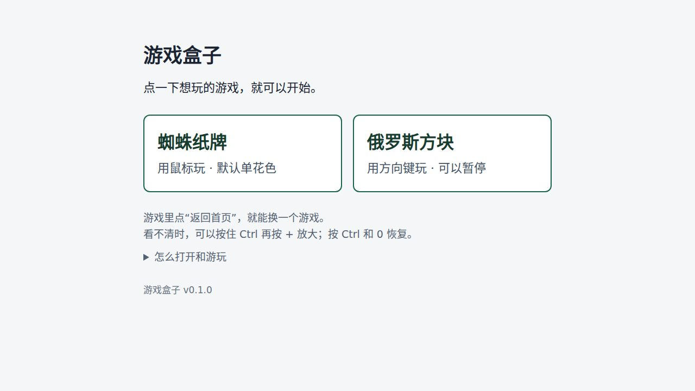
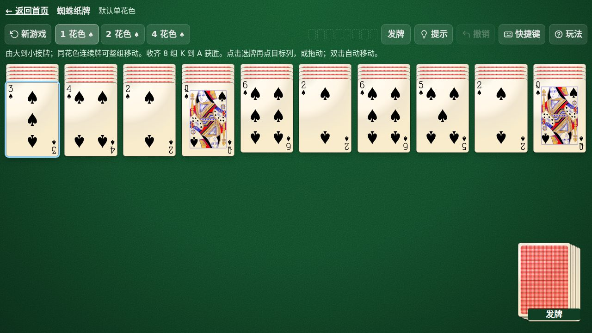
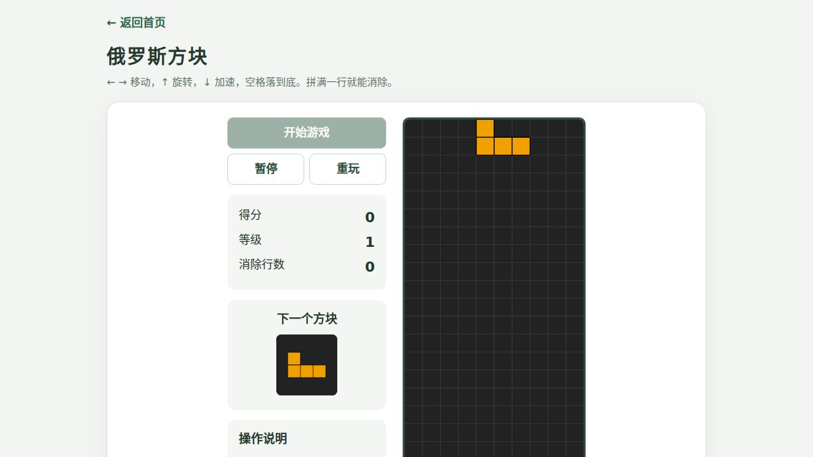

# 游戏盒子

[](https://github.com/Jerry2262/gamebox/actions/workflows/ci.yml)

把《蜘蛛纸牌》和《俄罗斯方块》打成一个 HTML 文件，拷到 Windows 桌面双击就能玩：不联网、不安装、不依赖任何外部文件。



## 它解决什么问题

公司电脑、老机器、内网环境常常装不了软件，也不方便联网。成品只有一个文件，发给对方后双击、用 Edge 打开、直接开玩。断网和 `file://` 下都可用，运行期间没有任何网络请求。

## 快速开始

在线试玩：打开 <https://jerry2262.github.io/gamebox/>，点想玩的游戏。

离线使用：

1. 下载 [`游戏盒子.html`](游戏盒子.html)
2. 放到桌面，双击，用 Microsoft Edge 打开
3. 点想玩的游戏

也可以下载 [Release](https://github.com/Jerry2262/gamebox/releases) 里的 zip，内容是同一个 HTML 加一份中文使用说明。

## 包含的游戏

### 蜘蛛纸牌

默认单花色，可切换 1/2/4 花色。点击选牌再点目标列，或直接拖动；双击自动移动。提供提示、撤销、发牌和自动收齐，有空列时不能发牌。



### 俄罗斯方块

方向键移动和旋转，空格落到底，P 或 Esc 暂停。有下一块预览、等级加速、得分和消除行数。



## 开发和复测

构建和打包只需要 Python 3；浏览器测试需要 Node.js 和 Playwright（约 640 MB，只用于测试，不参与交付）。

```bash
python3 build-single.py        # 生成 游戏盒子.html
python3 pack.py                # 先构建，再打出发布 zip

npm run test:unit              # 纸牌规则 + 单文件自包含，不需要浏览器

npm install
PLAYWRIGHT_BROWSERS_PATH="$PWD/.browsers" npx playwright install chromium
PLAYWRIGHT_BROWSERS_PATH="$PWD/.browsers" npm test
PLAYWRIGHT_BROWSERS_PATH="$PWD/.browsers" node tests/release.test.cjs
```

`npm test` 在断网 `file://` 下跑分文件版和单文件版：真实鼠标点击与拖拽、键盘、发牌撤销、暂停与消行，并检查脚本错误和网络请求。`tests/release.test.cjs` 把成品单独复制到空目录再打开，确认脱离仓库也能运行。

## 目录结构

```
游戏盒子.html          成品：全部资源内嵌的单文件
游戏盒子-v0.1.0.zip    发布包：成品 + 使用说明
gamebox/               分文件版源码（首页、蜘蛛纸牌、俄罗斯方块、使用说明）
build-single.py        构建单文件
pack.py                构建并打包发布 zip
tests/                 四个自检脚本
VERSION                版本号唯一来源
docs/screenshots/      README 截图
.github/workflows/     CI 检查；pages.yml 把 gamebox/ 发布到 GitHub Pages
```

分文件版是把两款游戏作为独立 HTML 放在 `gamebox/`，首页在 `gamebox/index.html`；单文件版用 `iframe.srcdoc` 内嵌这两页，游戏里的“返回首页”通过 `postMessage` 通知父页面卸载 iframe，从而停掉游戏定时器。全程没有外部请求、ES module 或 Web Worker。`gamebox/` 目录同时是 GitHub Pages 站点的根目录，由 `.github/workflows/pages.yml` 在推送 `main` 时发布。

## 版本

版本号只看根目录的 `VERSION`，格式 `v主.次.修订`。`build-single.py` 把它写进成品页脚，`pack.py` 用它命名 zip 并先构建；其余文件不重复记录版本。发布时打对应的 git tag。

## 已知边界

- 只在 Linux Chromium 上验证过，没有 Windows 11 Edge 实机和企业组策略环境验证。
- 退出或返回首页不保存当前局。
- 蜘蛛纸牌的提示是启发式建议，不保证通关。
- 尚未包含五子棋。

## 许可证

[MIT](LICENSE)
